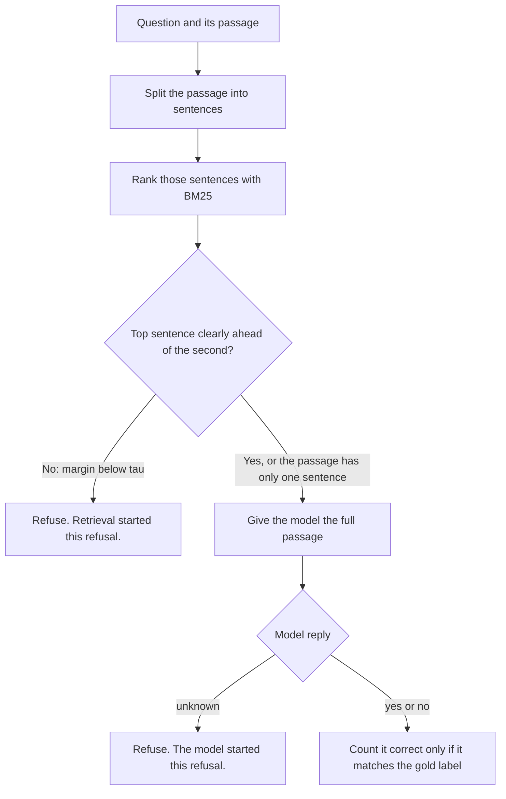

# When to Answer

Imagine a yes-or-no question, such as "Is this train station inside the fare zone?" A computer is given a short article that should hold the answer. The article may talk about the station and still never say whether it is inside the zone. Many systems guess anyway, and the guess is often wrong.

This project asks a simple question: when should the computer answer, and when should it say "I don't know"?

Each example comes from a public set of questions called BoolQ. Every example has one question, one article, and a known correct answer: yes or no. The computer may use only that article. It picks the sentence that best matches the question. When that sentence is clearly more relevant than the next sentence, the computer answers. When the two sentences are close, it refuses.

The sections below name the steps, the data, the scores, and the files in this project.

## The decision



The computer splits the article into sentences. A piece shorter than 40 characters is dropped. If that would leave no sentence, the whole article is kept.

It then scores each sentence against the question with BM25. BM25 is a simple word-overlap score: a sentence ranks higher when it shares uncommon words with the question.

The **margin** is the gap between the best sentence and the second-best:

margin = BM25(s1) − BM25(s2)

If that gap is small, the computer refuses. If the article has only one usable sentence, there is no second score, so the computer always tries to answer.

The cutoff for “small” is named τ. It is chosen on 200 practice questions, then left unchanged for the final 1,000 questions.

## Methods

Four methods are scored on the same 1,000 test questions. The reader is `Qwen/Qwen2.5-1.5B-Instruct`, used zero-shot. It must reply with one word: `yes`, `no`, or `unknown`.

| Method | Context | When it counts as correct |
|---|---|---|
| Always Yes | No model. Predict yes every time. | The gold label is yes. |
| Full Passage | The whole passage. | The reply matches the gold label. |
| Top Sentence | Only the top BM25 sentence. | The reply matches the gold label. |
| Answer or Abstain | The whole passage, only if the margin is at least τ. | The reply matches the gold label. A low margin, or a model reply of unknown, is a refusal. |

Accuracy is correct answers divided by questions the method actually answered. Coverage is the fraction of the 1,000 questions it answered. The first three methods answer every question, so their coverage is 1.00. Answer or Abstain also reports how many refusals came from the margin and how many came from the model.

## Results

On the 200 development questions, the search chose **τ = 0.191741** (the 35th percentile of BM25 margins). That cutoff is frozen in `results/cutoff.json` before the test set is scored.

Test set, N = 1,000:

| Method | Accuracy | Coverage | Answered | Correct |
|---|---|---|---|---|
| Always Yes | 0.615 | 1.00 | 1,000 | 615 |
| Full Passage | 0.589 | 1.00 | 1,000 | 589 |
| Top Sentence | 0.492 | 1.00 | 1,000 | 492 |
| Answer or Abstain | 0.776 | 0.517 | 517 | 401 |

Always Yes is a strong baseline because 615 of the 1,000 gold labels are yes. The 1.5B reader, given the full passage, scores below that baseline. Using only the top BM25 sentence drops accuracy further, from 0.589 to 0.492. That gap is the retrieval failure this project measures.

Answer or Abstain raises accuracy to 0.776 by answering 517 questions and refusing the rest. Of the 483 refusals, **314** are retrieval refusals (`margin < τ`) and **169** are model refusals (the model replied `unknown` after the margin cleared).

## Error analysis

`results/errors.csv` holds the first 30 test questions where Full Passage was right and Top Sentence was wrong. Each row has one hand-assigned label:

| Label | Count | Meaning |
|---|---|---|
| `wrong_sentence` | 24 | The deciding fact is elsewhere in the passage, not in the top-ranked sentence. |
| `model_contradicted` | 4 | The top sentence already has the deciding fact; the reader still misread it. |
| `not_decidable` | 2 | Neither the sentence nor the full passage clearly settles yes or no. |

Most of these failures are retrieval, not reading.

## Data

The source is the BoolQ validation split: 3,270 yes/no questions with public labels. Records are shuffled once with `random.seed(42)` and then frozen:

| File | Rows after the shuffle | Role |
|---|---|---|
| `data/test.jsonl` | 0–999 (1,000 questions) | Final metrics only. |
| `data/dev.jsonl` | 1,000–1,199 (200 questions) | Choose τ only. |
| unused | the remaining 2,070 | Kept out of every run. |

Scripts read these frozen files directly.

## Layout

```text
boolq-when-to-answer/
├── README.md
├── requirements.txt
├── data/
│   ├── test.jsonl
│   └── dev.jsonl
├── src/
│   ├── prepare_data.py
│   ├── split_sentences.py
│   ├── run_bm25.py
│   ├── run_reader.py
│   ├── choose_cutoff.py
│   └── score.py
└── results/
    ├── cutoff.json
    ├── scores.csv
    ├── errors.csv
    └── replies/
        ├── full_passage.jsonl
        ├── full_passage_dev.jsonl
        ├── top_sentence.jsonl
        └── abstain.jsonl
```

This project does not train a new model, build a new search method, crawl the web, or add a chat screen.

## Attribution

The questions and articles come from BoolQ, a public yes/no question set by Clark et al. (2019). It is free to use under CC BY-SA 3.0.
